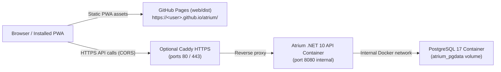

# Deployment & Backend Server Setup Guide

Atrium is designed so you can host the **frontend PWA on GitHub Pages** (free, fast, zero maintenance) while running the **API and PostgreSQL database in Docker containers** on your own server (a VPS, homelab, Raspberry Pi, or mini PC).



---

## Part 1: One-Click Backend Server Setup (Recommended)

The fastest way to host the API and PostgreSQL containers on any Linux server (Ubuntu, Debian, Fedora, Raspberry Pi OS, etc.) is the one-click setup script [`scripts/setup-server.sh`](../scripts/setup-server.sh).

### What the script does automatically
1. Checks for Docker Engine + Docker Compose v2 (and offers to install them automatically on Linux if missing).
2. Uses the current Atrium checkout or clones the repository into `~/atrium`.
3. Generates a strong, random 32-character PostgreSQL password and writes `.env` with `chmod 600` (preserving your existing password on re-runs so your database volume is never locked out).
4. Configures `CORS_ORIGINS` for your GitHub Pages frontend.
5. Optionally enables **automatic HTTPS via Caddy** (Let's Encrypt) if you provide a domain name.
6. Builds and starts the `postgres`, `api` (and optional `caddy`) containers.
7. Waits for `/api/health` to report `{"status":"ok","database":"connected"}` and prints your connection details.

### Run directly on a fresh server (one command)
```bash
curl -fsSL https://raw.githubusercontent.com/andraskurtos/atrium/main/scripts/setup-server.sh | bash
```

### Or run from an existing clone
```bash
git clone https://github.com/andraskurtos/atrium.git
cd atrium
./scripts/setup-server.sh
```

### Non-interactive / automated examples
**With automatic HTTPS (recommended for public VPS with a domain):**
```bash
./scripts/setup-server.sh -y \
  --domain api.example.com \
  --cors-origins https://andraskurtos.github.io
```

**Direct HTTP (for LAN, Tailscale, Cloudflare Tunnel, or an existing reverse proxy):**
```bash
./scripts/setup-server.sh -y \
  --port 5000 \
  --cors-origins https://andraskurtos.github.io
```

Run `./scripts/setup-server.sh --help` to see all available flags (`--dir`, `--branch`, `--bind`, `--skip-docker-install`, etc.).

---

## Part 2: Deploy the Frontend to GitHub Pages

The repository includes [`.github/workflows/deploy-pages.yml`](../.github/workflows/deploy-pages.yml), which automatically builds `web/` with the correct base path (including PWA manifest, service worker, and SPA `404.html` fallback) and publishes it to GitHub Pages.

### 1. Enable GitHub Pages via GitHub Actions
1. Open your repository on GitHub and go to **Settings → Pages**.
2. Under **Build and deployment → Source**, select **GitHub Actions**.

### 2. Connect the frontend to your backend server
You have two options (you can use either or both):

- **Option A — Configure in the browser (keeps your server URL private):**
  No GitHub variables required. Open your deployed GitHub Pages URL (e.g. `https://<username>.github.io/atrium/`), click **Configure**, paste your backend URL (e.g. `https://api.example.com`), and click **Connect**. The URL is saved locally in your browser's `localStorage`.
- **Option B — Pre-configure at build time via GitHub Actions variable:**
  1. Go to **Settings → Secrets and variables → Actions → Variables**.
  2. Create a repository variable named `VITE_API_BASE_URL` with your backend server URL (for example, `https://api.example.com` — no trailing slash).
  3. Trigger a deploy from **Actions → Deploy Frontend to GitHub Pages → Run workflow** (or push a change under `web/` to `main`).

> **Note on custom domains:** The workflow uses `actions/configure-pages@v5`, so `VITE_BASE_PATH` automatically adjusts between `/<repo>/` (default `github.io` URL) and `/` (custom domain).

---

## Part 3: Manual Backend Setup (Step-by-Step)

If you prefer setting up the containers manually without the bash script:

### Prerequisites
- Linux/macOS server with [Docker Engine](https://docs.docker.com/engine/install/) and Docker Compose v2 (`docker compose`)
- `git`

### Steps
1. **Clone the repository:**
   ```bash
   git clone https://github.com/andraskurtos/atrium.git
   cd atrium
   ```

2. **Create and lock down `.env`:**
   ```bash
   cp .env.example .env
   chmod 600 .env
   ```
   Edit `.env` and set:
   - `POSTGRES_PASSWORD`: a strong alphanumeric password (e.g. `openssl rand -base64 32 | tr -dc 'A-Za-z0-9' | head -c 32`)
   - `CORS_ORIGINS`: your GitHub Pages origin, scheme + host only — e.g. `https://andraskurtos.github.io` (no path, no trailing slash)
   - `ATRIUM_DOMAIN` *(optional)*: your API domain if using built-in Caddy HTTPS (e.g. `api.example.com`), and set `API_BIND_ADDRESS=127.0.0.1` so raw port `5000` is not exposed publicly

3. **Build and start the containers:**
   - **Standard (API + PostgreSQL):**
     ```bash
     docker compose up -d --build
     ```
   - **With automatic HTTPS (Caddy + API + PostgreSQL):**
     ```bash
     docker compose --profile https up -d --build
     ```

4. **Verify the server is healthy:**
   ```bash
   curl -s http://127.0.0.1:5000/api/health
   # Expected: {"status":"ok","database":"connected","timestamp":"..."}
   ```

---

## Part 4: HTTPS & Networking Options

Because GitHub Pages is served over **HTTPS**, browsers block `fetch()` requests to plain `http://` public URLs (**Mixed Content**). Choose whichever HTTPS setup fits your server:

### Option A: Built-in Automatic HTTPS with Caddy (Public VPS)
1. Point a DNS `A` (and/or `AAAA`) record for your subdomain (e.g. `api.example.com`) to your server's public IP.
2. Open TCP ports `80` and `443` in your firewall (e.g. `sudo ufw allow 80,443/tcp`).
3. Set `ATRIUM_DOMAIN=api.example.com` and `API_BIND_ADDRESS=127.0.0.1` in `.env`.
4. Start with `docker compose --profile https up -d --build`.

Caddy automatically obtains and renews Let's Encrypt TLS certificates using [`deploy/Caddyfile`](../deploy/Caddyfile).

### Option B: Zero Open Ports (Tailscale or Cloudflare Tunnel)
Great for a home server or Raspberry Pi behind NAT:
- Keep `API_BIND_ADDRESS=127.0.0.1` and `API_PORT=5000`, and start without the `https` profile (`docker compose up -d --build`).
- **Tailscale Serve** (private access only from your tailnet devices):
  ```bash
  tailscale serve --bg http://127.0.0.1:5000
  ```
- **Cloudflare Tunnel**: Point a tunnel hostname (e.g. `api.example.com`) to `http://127.0.0.1:5000`.

### Option C: Existing Reverse Proxy (Nginx / Traefik)
Set `API_BIND_ADDRESS=127.0.0.1` and proxy HTTPS traffic to `http://127.0.0.1:5000`. The API already enables ASP.NET Core `ForwardedHeaders`, so standard `X-Forwarded-For` and `X-Forwarded-Proto` headers work out of the box.

```nginx
server {
    listen 443 ssl http2;
    server_name api.example.com;

    location / {
        proxy_pass http://127.0.0.1:5000;
        proxy_set_header Host $host;
        proxy_set_header X-Real-IP $remote_addr;
        proxy_set_header X-Forwarded-For $proxy_add_x_forwarded_for;
        proxy_set_header X-Forwarded-Proto $scheme;
    }
}
```

---

## Part 5: Day-2 Operations & Maintenance

Run these commands inside your Atrium server directory (add `--profile https` when using Caddy):

| Task | Command |
| :--- | :--- |
| Check container status | `docker compose ps` |
| Stream live logs | `docker compose logs -f api postgres` |
| Update to latest code | `git pull && docker compose up -d --build` |
| Restart containers | `docker compose restart` |
| Stop containers (keeps DB data) | `docker compose down` |
| Backup PostgreSQL | `docker compose exec -T postgres pg_dump -U atrium atrium > atrium-backup.sql` |
| Restore PostgreSQL | `cat atrium-backup.sql \| docker compose exec -T postgres psql -U atrium atrium` |

---

## Troubleshooting

### Browser shows "API offline" on GitHub Pages
1. **Check HTTPS / Mixed Content:** Open browser DevTools → Console. If you see *Mixed Content*, your backend URL is `http://` while GitHub Pages is `https://`. Enable HTTPS via Caddy, Tailscale Serve, or Cloudflare Tunnel.
2. **Check CORS:** Verify `CORS_ORIGINS` in `.env` matches the exact origin in your browser address bar (scheme + host only, e.g. `https://andraskurtos.github.io`, **without** `/atrium` or a trailing slash). Restart the API after editing `.env`:
   ```bash
   docker compose up -d api
   ```
3. **Test CORS from curl:**
   ```bash
   curl -i -H "Origin: https://andraskurtos.github.io" https://api.example.com/api/health
   # Look for: Access-Control-Allow-Origin: https://andraskurtos.github.io
   ```

### API reports `503 {"status":"degraded","database":"unreachable"}`
Check `docker compose logs postgres api`. If you changed `POSTGRES_PASSWORD` in `.env` after the `atrium_pgdata` volume was already initialized, PostgreSQL keeps the original password stored inside the volume. Either restore the previous password in `.env` or update the password inside PostgreSQL (`ALTER USER atrium WITH PASSWORD '...';`).
