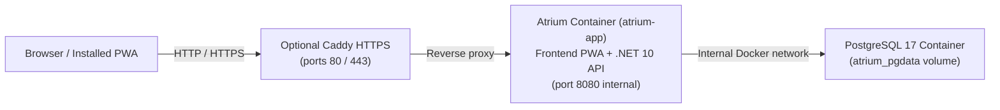

# Self-Hosted Server Setup Guide

Atrium runs as a **single-origin self-hosted stack** in Docker containers — the built React PWA frontend, the `.NET 10` API, and PostgreSQL 17 database all run together via one setup, with zero CORS configuration and optional automatic HTTPS.



---

## Part 1: One-Click Setup (Recommended)

Use [`scripts/setup-server.sh`](../scripts/setup-server.sh) on any Linux server (VPS, Raspberry Pi, homelab, or your local Linux/macOS machine with Docker).

### What the script does automatically
1. Checks for Docker Engine + Docker Compose v2 (and offers to install them automatically on Linux if missing).
2. Uses your current Atrium checkout (or clones the repo into `~/atrium`).
3. Generates a strong, random 32-character PostgreSQL password and writes `.env` with `chmod 600` (preserving your existing password on re-runs so your database volume is never locked out).
4. Optionally enables **automatic HTTPS via Caddy** (Let's Encrypt) if you provide a domain name.
5. Builds the multi-stage Docker image (React PWA + `.NET 10` API) and starts the `postgres`, `atrium` (and optional `caddy`) containers.
6. Verifies both `/api/health` (`{"status":"ok","database":"connected"}`) and the frontend PWA (`/`) are responding cleanly.

### Run from a cloned repository
```bash
git clone git@github.com:andraskurtos/atrium.git
cd atrium
./scripts/setup-server.sh
```

> **Private repository note:** Authenticate to GitHub on your server before cloning (for example, via an SSH deploy key in **Settings → Deploy keys** or `gh auth login`). If the repo is public, you can also run directly without cloning first:
> ```bash
> curl -fsSL https://raw.githubusercontent.com/andraskurtos/atrium/main/scripts/setup-server.sh | bash
> ```

### Non-interactive / automated examples
**Local / LAN / Tailscale / Cloudflare Tunnel (HTTP on port 5000):**
```bash
./scripts/setup-server.sh -y --port 5000
```

**Public VPS with automatic HTTPS (Let's Encrypt via Caddy):**
```bash
./scripts/setup-server.sh -y --domain atrium.example.com
```

Run `./scripts/setup-server.sh --help` to see all options (`--dir`, `--branch`, `--bind`, `--skip-docker-install`, etc.).

---

## Part 2: Manual Setup (Step-by-Step)

If you prefer setting up the containers manually without the bash script:

### Prerequisites
- [Docker Engine](https://docs.docker.com/engine/install/) + Docker Compose v2 (`docker compose`)
- `git`

### Steps
1. **Clone the repository:**
   ```bash
   git clone git@github.com:andraskurtos/atrium.git
   cd atrium
   ```

2. **Create and lock down `.env`:**
   ```bash
   cp .env.example .env
   chmod 600 .env
   ```
   Edit `.env` and set:
   - `POSTGRES_PASSWORD`: a strong alphanumeric password (e.g. `openssl rand -base64 32 | tr -dc 'A-Za-z0-9' | head -c 32`)
   - `API_PORT`: host port to serve Atrium on (default `5000`)
   - `ATRIUM_DOMAIN` *(optional)*: your domain if enabling automatic HTTPS with Caddy (also set `API_BIND_ADDRESS=127.0.0.1` so raw port `5000` is not exposed publicly)

3. **Build and start the containers:**
   - **Local / LAN / Tunnel (Frontend + API + PostgreSQL):**
     ```bash
     docker compose up -d --build
     ```
   - **With automatic HTTPS (Caddy + Frontend + API + PostgreSQL):**
     ```bash
     docker compose --profile https up -d --build
     ```

4. **Verify Atrium is running:**
   ```bash
   curl -s http://127.0.0.1:5000/api/health
   # Expected: {"status":"ok","database":"connected","timestamp":"..."}
   ```
   Then open `http://localhost:5000` (or `https://<your-domain>`) in your browser — you should see Atrium with the green **API & Postgres connected** indicator.

---

## Part 3: HTTPS & Remote Access Options

For installing Atrium as a **PWA** on mobile/desktop outside `localhost` (and for future WebAuthn/passkeys), serve Atrium over **HTTPS**. Pick whichever option matches how you host:

### Option A: Localhost / Home LAN (Fastest)
- Leave `ATRIUM_DOMAIN` blank and run `docker compose up -d --build`.
- Open `http://localhost:5000` on the host machine (or `http://<server-lan-ip>:5000` on your local network).

### Option B: Built-in Automatic HTTPS with Caddy (Public VPS + Domain)
1. Point a DNS `A` (and/or `AAAA`) record for your domain (e.g. `atrium.example.com`) to your server's public IP.
2. Open TCP ports `80` and `443` in your firewall (e.g. `sudo ufw allow 80,443/tcp`). Keep ports `5000` and `5433` closed.
3. Run `./scripts/setup-server.sh --domain atrium.example.com` (or set `ATRIUM_DOMAIN=atrium.example.com` and `API_BIND_ADDRESS=127.0.0.1` in `.env` and run `docker compose --profile https up -d --build`).

Caddy automatically obtains and renews Let's Encrypt TLS certificates using [`deploy/Caddyfile`](../deploy/Caddyfile).

### Option C: Zero Open Ports (Tailscale Serve or Cloudflare Tunnel)
Ideal for a home server or Raspberry Pi behind NAT — no port forwarding required:
- Run `./scripts/setup-server.sh -y --bind 127.0.0.1 --port 5000` so Atrium listens only on loopback.
- **Tailscale Serve** (private HTTPS accessible only from your Tailscale devices):
  ```bash
  tailscale serve --bg http://127.0.0.1:5000
  ```
- **Cloudflare Tunnel** (public HTTPS on your domain): point a tunnel hostname to `http://127.0.0.1:5000`.

### Option D: Existing Reverse Proxy (Nginx / Traefik)
Set `API_BIND_ADDRESS=127.0.0.1` and proxy HTTPS traffic to `http://127.0.0.1:5000`. Atrium already enables ASP.NET Core `ForwardedHeaders` (`X-Forwarded-For`, `X-Forwarded-Proto`).

```nginx
server {
    listen 443 ssl http2;
    server_name atrium.example.com;

    location / {
        proxy_pass http://127.0.0.1:5000;
        proxy_set_header Host $host;
        proxy_set_header X-Real-IP $remote_addr;
        proxy_set_header X-Forwarded-For $proxy_add_x_forwarded_for;
        proxy_set_header X-Forwarded-Proto $scheme;
    }
}
```

---

## Part 4: Day-2 Operations & Maintenance

Run these commands inside your Atrium directory (add `--profile https` when using Caddy):

| Task | Command |
| :--- | :--- |
| Check container status | `docker compose ps` |
| Stream live logs | `docker compose logs -f atrium postgres` |
| Update to latest code | `git pull && docker compose up -d --build` |
| Restart containers | `docker compose restart` |
| Stop containers (keeps DB data) | `docker compose down` |
| Backup PostgreSQL | `docker compose exec -T postgres pg_dump -U atrium atrium > atrium-backup.sql` |
| Restore PostgreSQL | `cat atrium-backup.sql \| docker compose exec -T postgres psql -U atrium atrium` |

---

## Troubleshooting

### Status pill shows `API online · Postgres unreachable` (`503`)
Check `docker compose logs postgres atrium`. If you edited `POSTGRES_PASSWORD` in `.env` after the `atrium_pgdata` volume was already initialized, PostgreSQL keeps the original password stored inside the volume. Either restore the previous password in `.env` or update it inside Postgres (`ALTER USER atrium WITH PASSWORD '...';`).

### Port `5000` is already in use
Re-run `./scripts/setup-server.sh --port 8080` (or change `API_PORT=8080` in `.env` and run `docker compose up -d`).

### Caddy fails to obtain a TLS certificate
Confirm that:
1. Your domain's DNS `A`/`AAAA` record resolves to this server's public IP.
2. Both TCP ports `80` and `443` are open in your server firewall and cloud security group.
3. Check details with `docker compose --profile https logs caddy`.
